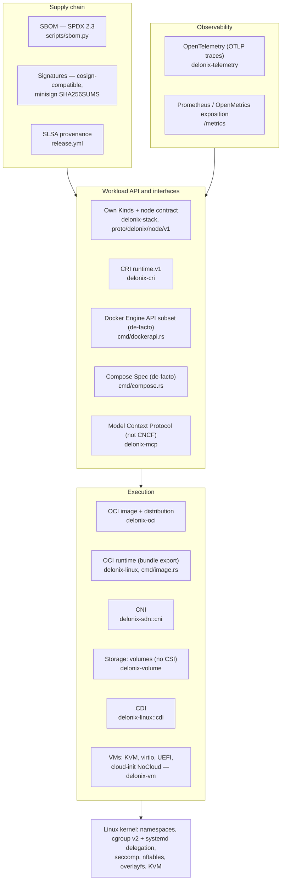

<!-- translated-from: cloud-native-standards.md sha256:03b24fe646c330c5610fac780bb582618e4c045753949fecac6f03f9f6176e12 -->
# Standards cloud native, couche par couche

**Avant de lire :** [Introduction au cloud native](cloud-native-primer.md) (comment le moteur utilise chaque mécanisme) et [Architecture](architecture.md) (les crates nommés ci-dessous). C'est une page de référence : lisez la section du standard qui vous concerne.

Un moteur de containers et de microVMs n'est pas une spécification unique. C'est un empilement de
couches, et la plupart des couches ont un standard ouvert : certains viennent de l'**OCI** (Open
Container Initiative), d'autres des SIG Kubernetes et de la **CNCF** (Cloud Native Computing
Foundation), d'autres du noyau Linux, et quelques-uns sont des interfaces de facto sans organisme de
normalisation derrière elles.

Cette page est organisée **par standard et par couche**. Pour chacun, elle répond à quatre questions :
ce qu'est le standard, ce qu'il exige d'une implémentation, comment Delonix l'implémente aujourd'hui
(crate, fichier, symbole), et ce que disent les éléments de preuve sur la conformité, lacunes
comprises. Si vous cherchez « OCI, CRI, CNI, CSI, CDI », c'est cette page. Une fois la section dont vous
avez besoin lue, vous pouvez dire ce qu'un standard demande, où le moteur le satisfait, et quelle preuve
de conformité existe — avec sa date et sa version.

Lisez d'abord [Fondations Linux](linux-foundations.md) et [Introduction au cloud native](cloud-native-primer.md)
si les namespaces, les cgroups, overlayfs ou le kubelet sont nouveaux pour vous. Cette page suppose ces
bases acquises et ne les répète pas : le primitif est enseigné dans la première, la façon dont le moteur
l'utilise dans la deuxième, et le standard et sa conformité ici.

Trois règles pour lire cette page :

- **« Compatible » n'apparaît jamais sans un nombre, une date et une version.** Une affirmation de
  conformité que personne ne remesure cesse d'être une mesure et devient une citation.
- **« Non implémenté » est une réponse à part entière.** Lorsque le moteur n'implémente pas un standard,
  la section le dit et renvoie à la décision (ADR) qui explique pourquoi.
- **Les chemins sont relatifs à la racine du dépôt**, et chaque symbole nommé ici a été lu dans le code.
  Si un symbole a bougé au moment où vous lisez ceci, faites confiance au code et corrigez la page.

---

## 13.0 La carte des couches

Chaque flèche signifie « est construit sur ». La couche du noyau n'est pas un standard CNCF ; elle est
couverte en 13.15 parce que toutes les autres couches en dépendent.

---

## 13.1 Spécification OCI Runtime

**Ce qu'est le standard.** La [spécification OCI Runtime](https://github.com/opencontainers/runtime-spec)
définit un *filesystem bundle* (un système de fichiers racine plus un `config.json`) et le cycle de vie
d'un container créé à partir de celui-ci (`create`, `start`, `kill`, `delete`, `state`). C'est ce
qu'implémentent `runc`, `crun` et `youki`, et ce que pilotent containerd et CRI-O.

**Ce qu'une implémentation doit faire.**

- Lire un bundle : `config.json` avec `ociVersion`, `process`, `root`, `mounts`, `linux` (namespaces,
  capabilities, cgroups, chemins masqués et en lecture seule, seccomp).
- Exposer les opérations de cycle de vie et le document `state`, et exécuter les hooks que la config
  déclare (`prestart`, `createRuntime`, `poststop`, …).

**Comment Delonix l'implémente.** Delonix n'est **pas un binaire OCI runtime** au sens de `runc` : il ne
lit pas de bundle et n'expose pas la ligne de commande `create/start/state`. C'est son propre runtime,
et il se rapporte à la spécification de deux façons :

1. **Il produit des bundles pour les OCI runtimes.** `delonix image export <image> <dir>` écrit
   `<dir>/rootfs` et `<dir>/config.json` pour que `runc run -b <dir>` puisse exécuter l'image.
   - `bins/delonix-runtime-bin/src/cmd/image.rs` : `cmd_export` dépaquette le rootfs via
     `ImageStore::export_rootfs` (`crates/adapters/delonix-oci/src/overlay.rs`) et construit la config
     avec `build_runtime_spec`.
   - `build_runtime_spec` construit la config à partir des types `oci_spec::runtime` (le crate
     `oci-spec`, épinglé dans le `Cargo.toml` racine) au lieu de JSON écrit à la main. Son commentaire de
     documentation liste ce qui manquait à un bundle antérieur écrit à la main (montages standard,
     capabilities effectives, chemins masqués/en lecture seule).
2. **Il implémente les mêmes mécanismes nativement.** `fn spawn` et `container_init` dans
   `crates/adapters/delonix-linux/src/lib.rs` font ce qu'un OCI runtime fait à partir d'un `config.json` :
   namespaces, `pivot_root`, capabilities, seccomp, chemins masqués. La spécification d'exécution qu'ils
   consomment n'est pas `config.json` mais `RunOpts`
   (`crates/contexts/delonix-compute/src/run_opts.rs`), que chaque front-end (CLI, Kinds, compose, API
   Docker, CRI) produit.

**Statut de conformité / lacunes.**

- Aucune suite de conformité runtime-spec n'a été exécutée contre Delonix. Elle ne pourrait pas l'être :
  il n'y a aucun point d'entrée consommateur de bundle contre lequel l'exécuter.
- **Les hooks OCI ne sont pas implémentés.** [ADR-0033](../adr/0033-oci-runtime-hooks.md) (Proposed)
  consigne pourquoi : aucun consommateur concret, et exécuter un binaire hôte nommé par une spec de
  container est la classe de sécurité que le projet garde déjà derrière un spike. La closure
  `StartedHook` en processus dans `delonix-linux` ressemble à cela mais n'est pas le protocole OCI.
- Le bundle exporté est minimal (commande, env et cwd par défaut depuis l'image). Traitez-le comme un
  format de transmission, pas comme une traduction de la configuration complète d'un container.

**Par où commencer la lecture.** `cmd_export` et `build_runtime_spec` dans
`bins/delonix-runtime-bin/src/cmd/image.rs` → `export_rootfs` dans
`crates/adapters/delonix-oci/src/overlay.rs` → `spawn` dans `crates/adapters/delonix-linux/src/lib.rs`.

---

## 13.2 Spécification OCI Image

**Ce qu'est le standard.** La [spécification OCI Image](https://github.com/opencontainers/image-spec)
définit comment une image est décrite : un *manifest* listant un blob de *config* et des blobs de
*layer* ordonnés, un *image index* pour plusieurs plateformes, adressé par le contenu via digest, et le
format de répertoire *image layout* (`oci-layout`, `index.json`, `blobs/sha256/…`).

**Ce qu'une implémentation doit faire.**

- Adresser tout le contenu par digest et le vérifier.
- Comprendre les manifests, les index (sélectionner la bonne plateforme) et les types de média de layer
  (tar, gzip, zstd), et appliquer les layers dans l'ordre, whiteouts compris.
- Lire et écrire l'image layout lors de l'échange d'images sans registre.

**Comment Delonix l'implémente.** Tout dans `crates/adapters/delonix-oci` :

- **Store adressé par contenu** : `src/cas.rs` (`Cas`), avec `ImageStore` dans `src/image.rs`.
- **Layers comme lowers d'overlay** : `ImageStore::prepare_overlay` (`src/overlay.rs`) écrit un fichier
  `overlay-lowers` à côté du `merged/` du container, et le propre init du container le monte. Les layers
  sont partagés entre containers, pas copiés (voir les notes containers-share-layers dans `AGENTS.md` et
  [ADR-0037](../adr/0037-overlay-mount-new-api.md) pour l'API de montage).
- **Type de média de layer par nombre magique** : l'assistant à côté de `DOCKER_MANIFEST_MEDIA_TYPE` dans
  `src/registry.rs` détecte gzip, zstd ou tar brut.
- **Écriture de l'image layout** : `write_oci_archive` (`src/save.rs`), utilisé par `delonix image save`.
  Il écrit `oci-layout`, `index.json`, les blobs, et un `manifest.json` hérité pour qu'une archive se
  lise dans `ctr images import`, `podman load`, `docker load` et `delonix image load`. Il fixe à la fois
  `org.opencontainers.image.ref.name` et `io.containerd.image.name` ; sans le second, `ctr` importe les
  blobs mais n'enregistre aucun nom.
- **Lecture d'archives** : `load_docker_archive` (`src/load.rs`).

**Statut de conformité / lacunes.**

- **Les manifests poussés et archivés utilisent le type de média Docker v2 schema 2**
  (`application/vnd.docker.distribution.manifest.v2+json`, `DOCKER_MANIFEST_MEDIA_TYPE` dans
  `src/registry.rs`), pas `application/vnd.oci.image.manifest.v1+json`. Les pulls acceptent les deux
  (`ACCEPT_MANIFEST`). C'est interopérable avec les registres et importeurs nommés ci-dessus, mais ce
  n'est pas « écrit des manifests d'image OCI ».
- Aucune suite de conformité image-spec n'a été exécutée.

**Par où commencer la lecture.** `src/image.rs` → `src/cas.rs` → `src/overlay.rs`
(`prepare_overlay`, `export_rootfs`) → `src/save.rs` → `src/load.rs`.

---

## 13.3 Spécification OCI Distribution

**Ce qu'est le standard.** La [spécification OCI Distribution](https://github.com/opencontainers/distribution-spec)
définit l'API HTTP d'un registre : `GET /v2/<name>/manifests/<reference>`, récupération et upload de
blobs, listage de tags, et le flux d'authentification par jeton que la plupart des registres utilisent.

**Ce qu'une implémentation doit faire.**

- Négocier les types de média de manifest avec `Accept`, suivre le flux `401 → token → retry`, récupérer
  les blobs et **vérifier chacun contre son digest**.
- Pour une référence par digest (`repo@sha256:…`), vérifier que le manifest lui-même hache vers ce digest.
- Pousser les blobs (avec contrôles d'existence) puis le manifest.

**Comment Delonix l'implémente.** `crates/adapters/delonix-oci/src/registry.rs` :

- `parse_reference` découpe `registry/repo:tag@digest` (y compris la forme combinée `tag@digest`).
- `pull_from_registry_with_creds` / `pull_from_registry_with_creds_full` tirent une image multi-layer ;
  les blobs déjà dans le CAS ne sont pas retéléchargés.
- **`verify_manifest_digest`** : pour un pull épinglé par digest, les octets du manifest doivent hacher
  vers le digest épinglé, ou le pull est refusé. Sans cela, un registre compromis pourrait servir un
  manifest différent, cohérent en interne, et l'épinglage serait décoratif. Pour une référence par tag
  c'est un no-op ; TLS est la seule intégrité, comme avec `docker pull`.
- `blob_with_progress_capped` reprend un téléchargement de blob interrompu avec `Range:`. Un `206` à un
  offset autre que celui demandé, ou un `200` qui a ignoré le range, repart de zéro au lieu d'être recousu.
  Le contrôle de digest final est ce qui rend le recousage sûr.
- `push_to_registry`, `build_manifest`, `list_remote_tags`.
- **Artefacts OCI** (blob unique, config vide `application/vnd.oci.empty.v1+json`, le motif qu'utilisent
  ORAS et Helm) : `push_oci_artifact*` et `pull_oci_artifact*`. Les images de VM sont publiées ainsi
  (voir [Construire des microVMs](microvm-setup.md)). Les annotations ne sont lues qu'*après* le contrôle
  de digest.
- Credentials : `src/auth.rs` lit le format `auths` de Docker/Podman.
- Un registre local jetable pour les builds buildpack : `src/internal_registry.rs`.

**Statut de conformité / lacunes.**

- Aucune exécution de conformité distribution-spec n'existe pour le client.
- `list_remote_tags` ne lit que la première page de `tags/list` (pas de pagination `Link`). Les notes
  d'`AGENTS.md` qualifient cela d'inutile pour la poignée de tags qu'a une image de VM ; cela compterait
  pour un gros dépôt.
- Le moteur n'implémente pas le côté *serveur* du registre, hormis le registre local jetable ci-dessus.

**Par où commencer la lecture.** `parse_reference` → `pull_from_registry_with_creds_full` →
`verify_manifest_digest` → `blob_with_progress_capped` → `pull_oci_artifact_with_meta`, tous dans
`src/registry.rs`.

---

## 13.4 Kubernetes Container Runtime Interface (CRI)

**Ce qu'est le standard.** La [CRI](https://github.com/kubernetes/cri-api) est l'API gRPC
(`runtime.v1`) que le kubelet utilise pour exécuter des pods : un `RuntimeService` (sandboxes de pod,
containers, exec/attach/port-forward, stats) et un `ImageService`. Le kubelet se connecte à un runtime
via `--container-runtime-endpoint`.

**Ce qu'une implémentation doit faire.**

- Servir les deux services sur un socket local ; rapporter `RuntimeReady` et `NetworkReady` dans `Status`.
- Implémenter le modèle de sandbox de pod : namespace réseau partagé, parent cgroup au niveau du pod,
  cycle de vie des containers à l'intérieur du sandbox.
- Renvoyer des **URLs** depuis `Exec`/`Attach`/`PortForward` et servir ces flux sur le protocole
  remotecommand de Kubernetes (WebSocket ou SPDY).
- Indiquer au kubelet son cgroup driver (`RuntimeConfig`), honorer les limites de ressources, rapporter
  les stats pour l'éviction, et écrire les logs au format de log CRI.

**Comment Delonix l'implémente.** `crates/interfaces/delonix-cri`, binaire `delonix-cri` (aussi
`delonix serve cri`) :

- **Contrat** : `proto/api.proto` déclare `package runtime.v1` avec
  `go_package = "k8s.io/cri-api/pkg/apis/runtime/v1"` ; `Version` répond
  `runtime_api_version: "v1"` (`src/runtime_svc.rs`).
- **Serveur** : `serve_blocking` dans `src/lib.rs` ; socket depuis `--addr` ou `DELONIX_CRI_ADDR`, par
  défaut `unix:///run/delonix-cri.sock` (`src/bin/delonix-cri.rs`).
- **Cycle de vie** : `src/runtime_svc.rs` (le trait gRPC) délègue à `src/runtime_svc/lifecycle.rs`.
- **Cgroup driver** : `runtime_config` répond `engine_cgroup_driver()`, qui est `Cgroupfs`. Son
  commentaire de documentation consigne la mesure qui a forcé cela (2026-09-15, k8s 1.36.4) : ne rien
  répondre faisait que le kubelet basculait par défaut sur `systemd`, systemd retirait `cpuset` des
  slices de pod vides, et le kubelet tuait les pods en boucle.
- **Modèle de ressources du kubelet** : [ADR-0038](../adr/0038-cri-follows-kubelet-resource-model.md). Le
  `cgroup_parent` du kubelet est validé par `KubeCgroupParent::parse`
  (`crates/contexts/delonix-compute/src/record.rs`) et consommé dans
  `crates/contexts/delonix-compute/src/run.rs` ; `delonix-linux` a `transient_scope_argv` pour placer un
  container dans un scope systemd sous un slice de pod.
- **Plafond de capabilities** : `CapCeiling` (`src/cap_ceiling.rs`), configuré par
  `DELONIX_CRI_CAP_CEILING` et `DELONIX_CRI_CAP_CEILING_MODE`, et visible dans `crictl info` comme
  `capabilityCeiling` (inséré dans `status`).
- **Streaming** : `src/streaming.rs` sert remotecommand sur WebSocket (`v5.channel.k8s.io`), et
  `src/spdy.rs` sur SPDY/3.1 ; `port_forward` renvoie une URL de streaming.
- **Stats et métriques** : `container_stats`, `list_pod_sandbox_stats`, `list_metric_descriptors` dans
  `lifecycle.rs`.
- **Réseau de pod** : voir 13.5.

**Statut de conformité / lacunes.**

- **Mesuré avec le `critest` amont** ([docs/cri-conformance.md](../cri-conformance.md)) : cri-tools
  `critest` **v1.36.0**, moteur `delonix-cri` **v0.63.1**, rootless, **2026-08-25** : **79 réussis,
  24 échoués, 19 sautés, sur 103 specs exécutées** (122 dans la suite). Échecs par domaine dans ce
  document : profils AppArmor par container, propagation de montage, parties du contexte de sécurité,
  image manager (pull par digest, `Uid`/`Username`), streaming port-forward, OOM, et quelques specs
  isolées. Ce nombre est plus ancien que plusieurs correctifs CRI consignés dans `AGENTS.md` ; il n'a
  pas été remesuré depuis. Reproduisez avec `scripts/critest.sh`.
- **Exercé manuellement avec `crictl`** le 2026-09-11 (selon `AGENTS.md`) : version, info, images, et le
  cycle `runp → create → start → exec`.
- **Validé contre un vrai kubelet** (k8s 1.36.4, 2026-09-15, selon `AGENTS.md` et le commentaire de
  documentation d'`engine_cgroup_driver`) : plan de contrôle à nœud unique stable, CoreDNS tournant avec
  un CNI en mode root.
- **RPC non implémentés** (ils renvoient `UNIMPLEMENTED`) : `UpdateContainerResources`,
  `CheckpointContainer`, `GetContainerEvents` (`src/runtime_svc.rs`).
- **Attention à un commentaire périmé** : `engine_cgroup_driver` dit que la réponse honnête `SYSTEMD`
  « needs the engine to place containers in a transient scope … until it does, this stays », alors que
  `transient_scope_argv` existe déjà dans `delonix-linux`. La réponse du driver est toujours `Cgroupfs` ;
  ne la changez pas sans réexécuter la mesure du kubelet dans le commentaire de documentation.

**Par où commencer la lecture.** `src/bin/delonix-cri.rs` → `serve_blocking` (`src/lib.rs`) →
`src/runtime_svc.rs` (`status`, `runtime_config`) → `run_pod_sandbox` dans
`src/runtime_svc/lifecycle.rs` → `src/cap_ceiling.rs` → `src/streaming.rs`.

---

## 13.5 Container Network Interface (CNI)

**Ce qu'est le standard.** La [spécification CNI](https://www.cni.dev/docs/spec/) définit comment un
runtime demande à des binaires de plugin de configurer un namespace réseau : une liste de configuration
réseau (`/etc/cni/net.d/*.conflist`), des binaires de plugin dans `CNI_PATH` (habituellement
`/opt/cni/bin`), et des opérations passées dans `CNI_COMMAND` avec la configuration sur stdin.

**Ce qu'une implémentation doit faire.**

- Charger la liste de configuration, résoudre chaque plugin dans `CNI_PATH`, et fixer `CNI_COMMAND`,
  `CNI_CONTAINERID`, `CNI_NETNS`, `CNI_IFNAME`, `CNI_PATH`.
- Pour `ADD`, exécuter les plugins dans l'ordre, en passant à chacun le résultat précédent comme
  `prevResult` ; pour `DEL`, les exécuter en sens inverse.
- Parser les résultats et les erreurs structurées ; passer `runtimeConfig` (par exemple `portMappings`)
  aux plugins qui déclarent la capacité. Les versions plus récentes de la spec ajoutent `CHECK`, `GC` et
  `STATUS`.

**Comment Delonix l'implémente.** Deux providers réseau existent, et CNI est l'un d'eux :

- **SDN natif** (le défaut pour les containers) : le netns holder rootless, le pont, l'IPAM, le pare-feu
  nftables — `crates/adapters/delonix-sdn` (voir
  [Introduction au cloud native 4.5](cloud-native-primer.md#45-container-networking) et
  [Architecture](architecture.md#rootless-network-infrastructure)).
- **Couche protocole CNI** : `crates/adapters/delonix-sdn/src/cni.rs`, pure et testable.
  `list_conf_files`, `parse_config`, `load_default`, `resolve_plugin`, `add` (chaîne `prevResult`),
  `del`, `plugin_dirs` (depuis `CNI_PATH`), `readiness` (la config parse **et** chaque binaire,
  `ipam.type` compris, est dans `CNI_PATH`), `attach_named_netns`, `detach_named_netns`,
  `set_netns_sysctls`.
- **Où CNI est utilisé** :
  - **CRI, mode root** : le réseau du pod est toujours la chaîne CNI du nœud, dans l'hôte, comme dans
    containerd. `run_pod_sandbox` (`crates/interfaces/delonix-cri/src/runtime_svc/lifecycle.rs`) crée
    `/run/netns/cri-<id>` et appelle `delonix_sdn::cni::attach_named_netns`. `NetworkReady` vient de
    `root_cni_readiness` (`src/runtime_svc.rs`), le même fait sur lequel le sandbox agit.
  - **CRI, rootless** : opt-in avec `DELONIX_CNI=1` plus une conflist (`enabled_conf`) ; les plugins
    s'exécutent à l'intérieur du holder qui possède le netns (`delonix_sdn::infra::cni_attach_container`).
    Sans le flag, les pods rootless utilisent le SDN natif.

**Statut de conformité / lacunes.**

- `cni.rs` documente le support des versions de configuration 0.4.0 et 1.0.0. `CHECK` existe comme
  variante de `Command_` mais n'est **jamais invoqué** ; `GC` et `STATUS` ne sont pas implémentés.
- `runtimeConfig` n'est pas passé aux plugins, donc `hostPort` à travers le plugin `portmap` ne
  fonctionne pas sur un sandbox CNI root (`AGENTS.md`, notes du 2026-09-15).
- Mesuré avec une vraie chaîne bridge/host-local sur un nœud kubeadm (2026-09-15, k8s 1.36.4, selon
  `AGENTS.md`) : nœud `Ready`, CoreDNS servant, DNS de Service résolu depuis un autre pod. Non mesuré :
  plus d'un nœud, et le chemin CNI rootless après son refactoring pour partager le corps d'`ADD`.
- Aucun outillage de conformité de plugin CNI n'a été exécuté contre le côté runtime.

**Par où commencer la lecture.** `crates/adapters/delonix-sdn/src/cni.rs` (commentaire de module, `add`,
`readiness`) → `run_pod_sandbox` dans `crates/interfaces/delonix-cri/src/runtime_svc/lifecycle.rs`
→ `root_cni_readiness` dans `src/runtime_svc.rs`.

---

## 13.6 Container Storage Interface (CSI)

**Ce qu'est le standard.** La [spécification CSI](https://github.com/container-storage-interface/spec)
est une API gRPC entre un orchestrateur et un driver de stockage : un service Identity, un service
Controller (créer/supprimer/publier des volumes) et un service Node (stage/publish dans le namespace de
montage d'un pod), enregistré auprès du kubelet.

**Ce qu'une implémentation doit faire.** Exécuter un plugin Node joignable sur chaque nœud pendant toute
la durée de vie des volumes qu'il sert (habituellement un DaemonSet avec des sidecars de registrar), et
habituellement un plugin Controller comme service de longue durée.

**Comment Delonix l'implémente.** **Il n'implémente pas CSI.** Le stockage est servi par le propre
`kind: Volume` du moteur :

- `crates/adapters/delonix-volume/src/lib.rs` : volumes nommés (`<root>/volumes/<name>/_data`) et bind
  mounts, tous deux `MS_BIND`, syntaxe Docker `-v`. `HostVolumes` implémente le port `StorageProvider`
  du contexte compute (`crates/contexts/delonix-compute/src/ports.rs`).
- Stockage réseau (NFS, CIFS/SMB, WebDAV) monté comme un volume, et un provisionneur de stockage contre
  une API NAS ([ADR-0009](../adr/0009-truenas-storage-provisioner.md), crate
  `crates/providers/delonix-truenas`).

**Statut de conformité / lacunes.** Non implémenté, par décision :
[ADR-0034](../adr/0034-csi-daemon-conflict.md) (Proposed). Un plugin CSI Node est un service permanent,
et le moteur est sans daemon par conception. L'ADR ne se rouvre que lorsqu'un besoin concret nomme
spécifiquement le protocole CSI **et** que la question du daemon a son propre ADR accepté. Il consigne
aussi le chemin pratique qui ne nécessite aucun code ici (un provisionneur NFS externe contre le même
serveur).

**Par où commencer la lecture.** [ADR-0034](../adr/0034-csi-daemon-conflict.md) →
`crates/adapters/delonix-volume/src/lib.rs` → `StorageProvider` dans
`crates/contexts/delonix-compute/src/ports.rs`.

---

## 13.7 Container Device Interface (CDI)

**Ce qu'est le standard.** Le [Container Device Interface](https://github.com/cncf-tags/container-device-interface)
décrit des devices (des GPU, par exemple) comme des specs JSON ou YAML dans `/etc/cdi` et `/var/run/cdi`.
Un nom pleinement qualifié tel que `nvidia.com/gpu=all` se résout en *container edits* : nœuds de device,
montages, variables d'environnement et hooks.

**Ce qu'une implémentation doit faire.** Charger les specs depuis les deux répertoires avec la précédence
définie, résoudre les noms qualifiés, et appliquer à la fois les `containerEdits` de premier niveau
indépendants du device et ceux par device, hooks compris.

**Comment Delonix l'implémente.** Comme **consommateur** de specs générées par un outil fournisseur
(`nvidia-ctk cdi generate`), jamais comme un outil de découverte de driver :

- `crates/adapters/delonix-linux/src/cdi.rs` : `is_cdi_qualified`, `ensure_cdi_available`,
  `resolve_cdi_device`, `expand_gpu_devices` ; répertoires de specs `/etc/cdi` puis `/var/run/cdi`.
- `HostDevices` implémente le port `DeviceResolver` (`crates/contexts/delonix-compute/src/ports.rs`),
  transformant les edits en les mêmes montages, liste de devices et environnement que produisent `-v` et
  `--device`. Le propre init du container les applique avant `pivot_root` ; aucun second processus
  n'entre dans le container par PID.
- Surface CLI : `container run --gpus nvidia|all` et `--device nvidia.com/gpu=<name|all>`. Sans spec ni
  `nvidia-ctk`, le run est refusé avant que quoi que ce soit ne soit créé.

**Statut de conformité / lacunes.**

- **Les hooks ne sont pas exécutés.** Un `ldconfig -r <rootfs>` au mieux remplace le hook `createContainer`
  habituel, et une spec qui déclare des hooks produit un avertissement visible. C'est le coût nommé de
  [ADR-0033](../adr/0033-oci-runtime-hooks.md).
- Le commentaire de module consigne une mesure contre une spec de `nvidia-ctk` 1.20.0 (`cdiVersion`
  0.7.0) : les `containerEdits` de premier niveau portent la plupart des nœuds de device et tous les
  montages, donc ne lire que les edits par device casse CUDA. Le commentaire ne donne pas de date, et il
  n'a pas été remesuré pour cette page. `AGENTS.md` liste la précédence exacte entre les deux répertoires
  et si `ldconfig -r` suffit comme « to confirm on a real GPU host ».

**Par où commencer la lecture.** `crates/adapters/delonix-linux/src/cdi.rs` (commentaire de module,
`resolve_cdi_device`, `HostDevices`) → `DeviceResolver` dans
`crates/contexts/delonix-compute/src/ports.rs`.

---

## 13.8 L'API de charge de travail : Kinds propres et contrat de nœud

**Ce qu'est le standard.** Il n'y a pas de standard externe ici, à dessein. Le moteur expose ses propres
**Kinds** déclaratifs dans ses propres groupes d'API (`core`, `compute`, `networking`, `gateway`,
`storage`, `artifact`, `infrastructure` ; listez-les avec `delonix api-resources`). La forme suit les
conventions Kubernetes (`apiVersion`, `kind`, `metadata`, `spec`) sans prétendre à la compatibilité avec
l'API Kubernetes.

**Ce qu'une implémentation doit faire** (les propres règles du moteur) :

- Publier le schéma de manifeste généré depuis le code, pas écrit à la main
  ([ADR-0007](../adr/0007-generated-manifest-schema.md)).
- Planifier, appliquer et détecter la dérive avec un diff à trois voies, et ne jamais ignorer un champ
  silencieusement.
- Servir un contrat de nœud sur gRPC et HTTP/JSON sur le même socket local, avec le document OpenAPI
  généré depuis le protobuf
  ([ADR-0040](../adr/0040-engine-restructuring-layers-ports-node-contract.md), Proposed ;
  [ADR-0041](../adr/0041-node-local-contract-for-the-control-plane-agent.md)).

**Comment Delonix l'implémente.**

- Table des Kinds : `crates/contexts/delonix-stack/src/kinds.rs` (l'`api_version`, le domaine, la
  convergence, le teardown de chaque Kind). Réconciliateur : `src/reconcile.rs`.
- Schéma publié : `docs/schema/v1/delonix.json`.
- Contrat de nœud : `proto/delonix/node/v1/*.proto`, avec `docs/api/openapi.yaml` généré et vérifié par
  `scripts/contract_gate.py`. Servi en partie par `delonix serve node-api`
  (`crates/interfaces/delonix-node-api`) : `NodeService.ListProviders` en gRPC et comme
  `GET /v1/providers` ; les autres RPC répondent `UNIMPLEMENTED`.

**Statut de conformité / lacunes.** Protégé par la CI (le test de schéma, `contract_gate.py`), pas par
une suite externe. Voir [Architecture](architecture.md) et [Conception système](system-design-interview.md).

**Par où commencer la lecture.** `crates/contexts/delonix-stack/src/kinds.rs` →
`src/reconcile.rs` → `proto/delonix/node/v1/node.proto` → `scripts/contract_gate.py`.

---

## 13.9 Sous-ensemble de l'API Docker Engine — une interface de facto

**Ce qu'est le standard.** L'[API Docker Engine](https://docs.docker.com/reference/api/engine/) n'est
**pas un standard CNCF ou OCI**. C'est l'API REST d'un fournisseur que de nombreux outils parlent
(CLI `docker`, compose, kind, frameworks de test). Elle est incluse ici parce que c'est une vraie surface
d'interopérabilité.

**Ce qu'une implémentation doit faire.** Répondre à `/_ping` et à la négociation de version, puis aux
routes qu'un outil donné appelle, avec les formes JSON et les codes de statut de Docker.

**Comment Delonix l'implémente.** `bins/delonix-runtime-bin/src/cmd/dockerapi.rs`, servi par
`delonix serve docker-api [--addr unix://<socket>]` :

- `API_VERSION` est `"1.43"`, `MIN_API_VERSION` est `"1.24"` ; les préfixes de version sont retirés pour
  que `/v<version>/...` fonctionne.
- **La couverture est une table publiée** : `API_MATRIX` (routes servies) et `API_UNIMPLEMENTED` (routes
  refusées avec une raison). `delonix serve docker-api --matrix` les imprime, et un test échoue si un bras
  de dispatch existe sans entrée de matrice.
- Les routes de cycle de vie de container délèguent aux mêmes fonctions que la CLI. Le socket est `0600`
  avec `SO_PEERCRED` (même uid seulement).

**Statut de conformité / lacunes.**

- Le commentaire de module dit qu'il a été vérifié contre une vraie CLI `docker` 27.3.1 (sans date).
- Refusés aujourd'hui, avec les raisons dans `API_UNIMPLEMENTED` : `exec` et `attach` (nécessitent le
  détournement HTTP), `logs`, `events`, `build`, networks, `images/create` (le pull que la plupart des
  outils appellent en premier), `images/{name}/json`, `stats`, volumes. Lisez la table plutôt que de vous
  fier à cette liste ; la table est le contrat.
- Le modèle de réseau de Docker (`NetworkingConfig`) n'est pas traduit.

**Par où commencer la lecture.** `API_MATRIX` et `API_UNIMPLEMENTED` dans
`bins/delonix-runtime-bin/src/cmd/dockerapi.rs` → le `match` de dispatch dans le même fichier →
`tests/compat/docker_api_smoke.py`.

---

## 13.10 Spécification Compose — une spec de facto

**Ce qu'est le standard.** La [spécification Compose](https://compose-spec.io/) décrit une application
multi-container en YAML (`services`, `networks`, `volumes`, `secrets`, `configs`). C'est une spécification
ouverte maintenue par le projet Compose, **pas un standard CNCF ou OCI**.

**Ce qu'une implémentation doit faire.** Parser le modèle, ordonner les services par `depends_on` (avec
ses conditions), créer les réseaux et volumes, et ne pas changer silencieusement le sens d'un fichier.

**Comment Delonix l'implémente.** `bins/delonix-runtime-bin/src/cmd/compose.rs`
(`delonix compose up|down|ps|logs|config`) : un traducteur vers `RunOpts` et les propres documents
`Image`/`Network`/`Volume` du moteur, avec l'appartenance dérivée des labels.

**Statut de conformité / lacunes.**

- Les clés inconnues sont **refusées, pas ignorées** : `check_unsupported_fields` vérifie le YAML brut
  contre des listes blanches (`SUPPORTED_TOP`, `SUPPORTED_SERVICE`, …) et des listes noires avec raisons
  (`KNOWN_UNSUPPORTED_TOP`, `KNOWN_UNSUPPORTED_SERVICE`). Des notes plus anciennes ailleurs dans le
  workspace disent que les clés inconnues étaient avalées silencieusement ; le code ne le fait plus.
- `include:` est refusé (utilisez `-f a.yml -f b.yml`). Aucune suite de conformité Compose n'a été
  exécutée.

**Par où commencer la lecture.** Le commentaire de module et `check_unsupported_fields` dans `compose.rs`.

---

## 13.11 OpenTelemetry

**Ce qu'est le standard.** [OpenTelemetry](https://opentelemetry.io/) est le projet CNCF pour les traces,
les métriques et les logs, avec le protocole filaire OTLP pour les exporter vers un collecteur.

**Ce qu'une implémentation doit faire.** Émettre des spans avec des attributs de ressource (au moins
`service.name`), les exporter sur OTLP (gRPC ou HTTP), et vider (flush) avant que le processus ne sorte.

**Comment Delonix l'implémente.** `crates/adapters/delonix-telemetry/src/telemetry.rs` :

- Logs structurés via `tracing` (`DELONIX_LOG`, `DELONIX_LOG_FORMAT=json`).
- **Traces sur OTLP/HTTP protobuf** quand `DELONIX_OTLP_ENDPOINT` est défini (`build_otlp_layer`,
  `/v1/traces` ajouté s'il manque), avec un batch span processor sur son propre thread, pour qu'il
  fonctionne à la fois dans le serveur CRI asynchrone et dans la CLI synchrone. `service.name` distingue
  les binaires.

**Statut de conformité / lacunes** (tout énoncé dans le commentaire de module) :

- **Traces uniquement.** Les métriques passent par l'exposition Prometheus (13.12), pas OTLP ; il n'y a
  pas d'export de log OTLP.
- **HTTP simple uniquement.** Aucun backend TLS n'est compilé, par décision de supply chain ; un endpoint
  `https://` n'est pas supporté.
- La CLI de courte durée ne vide pas à la sortie, donc une invocation rapide peut perdre ses spans. Le
  chemin fiable est le `delonix-cri` de longue durée.

**Par où commencer la lecture.** Commentaire de module, `init` et `build_otlp_layer` dans
`crates/adapters/delonix-telemetry/src/telemetry.rs`.

---

## 13.12 Format d'exposition Prometheus

**Ce qu'est le standard.** Le [format d'exposition Prometheus](https://prometheus.io/docs/instrumenting/exposition_formats/)
et son successeur [OpenMetrics](https://github.com/prometheus/OpenMetrics) définissent le texte qu'une
cible de scrape sert sur `GET /metrics`.

**Ce qu'une implémentation doit faire.** Servir le texte avec le bon `Content-Type`, avec des noms et
types de métriques stables, assez vite pour le timeout de scrape.

**Comment Delonix l'implémente.**

- Un registre partagé : `crates/adapters/delonix-telemetry/src/metrics.rs` (`encode`, et des setters tels
  que `set_containers`, `set_vms`, `set_memory`, `set_network`, `set_storage`), construit sur le crate
  `prometheus-client`.
- `delonix-cri` : un listener `/metrics` optionnel activé par `DELONIX_METRICS_ADDR` (`src/lib.rs`,
  `metrics_handler`), séparé du socket gRPC.
- `delonix-mgmt` : `/metrics` sur son socket local (`crates/interfaces/delonix-mgmt/src/lib.rs`,
  `metrics`). Les champs bon marché sont calculés par scrape ; les coûteux (parcours de disque) sont
  rafraîchis en arrière-plan pour que les scrapes restent rapides.
- Les deux handlers servent `application/openmetrics-text; version=1.0.0; charset=utf-8`.
- **Séries de contention par charge de travail** (`delonix-mgmt` uniquement ;
  `crates/adapters/delonix-telemetry/src/workload.rs`, lues par
  `crates/adapters/delonix-linux/src/pressure.rs`). Elles répondent à « cette charge de travail a-t-elle
  obtenu le CPU et la mémoire promis par ses limites ? », un jeu de séries par container ou VM en cours,
  étiqueté `kind` (`container`/`vm`), `id` et `name`, et jamais par processus :

  | Métrique (préfixe `delonix_`) | Type | Source | Étiquettes supplémentaires |
  |---|---|---|---|
  | `workload_cpu_periods_total` | counter | `cpu.stat` `nr_periods` | |
  | `workload_cpu_throttled_periods_total` | counter | `cpu.stat` `nr_throttled` | |
  | `workload_cpu_throttled_seconds_total` | counter | `cpu.stat` `throttled_usec` | |
  | `workload_pressure_avg10_percent` | gauge | `{cpu,memory,io}.pressure` `avg10` | `resource`, `stall` (`some`/`full`) |
  | `workload_pressure_stall_seconds_total` | counter | `{cpu,memory,io}.pressure` `total` | `resource`, `stall` |
  | `workload_memory_oom_events_total` | counter | `memory.events.local` (else `memory.events`) `oom` | |
  | `workload_memory_oom_kills_total` | counter | `memory.events.local` (else `memory.events`) `oom_kill` | |
  | `workload_series_unavailable` | gauge, always 1 | | `group`, `reason` |

  Tout cela consiste en de simples lectures de fichiers dans le propre répertoire cgroup de la charge de
  travail : aucun nouveau privilège, aucun sous-processus. **Un fichier que l'hôte ne peut fournir ne
  donne aucune série, jamais un zéro**, et un échantillon `workload_series_unavailable{group,reason}` dit
  pourquoi. `group` est l'un de `cpu_throttle`, `cpu_pressure`, `memory_pressure`, `io_pressure`,
  `memory_events` ; `reason` est l'un de `cgroup_missing`, `not_cgroup_v2` (cgroup v1), `file_missing`
  (contrôleur non délégué, PSI compilé hors ou `cgroup_disable=pressure`), `psi_disabled` (`psi=0`),
  `unreadable`, `incomplete` (fichier présent mais sans les champs) et `shared_cgroup`. `full` est absent
  là où le noyau ne l'écrit pas (`cpu.pressure` sur les noyaux plus anciens).
- **VMs.** Le moteur ne crée aucun cgroup pour un VMM, qui tourne dans le cgroup où était son lanceur. Les
  séries d'une VM ne sont donc exportées que lorsque le VMM est le seul processus de son cgroup (par
  exemple un hyperviseur qui donne à chaque domaine un scope) ; sinon elles sont absentes avec
  `reason="shared_cgroup"`, car les chiffres d'un cgroup partagé ne sont pas ceux de la VM. **Le temps de
  vol (steal time) n'est pas exporté** : c'est un compteur côté invité (`/proc/stat` dans l'invité, depuis
  l'horloge paravirtuelle), et l'équivalent le plus proche de l'hôte, le délai de file d'attente des
  threads du VMM dans `/proc/<pid>/task/*/schedstat`, est une quantité différente (il compte aussi les
  threads non-vCPU et n'est pas monotone quand des threads sortent), donc le présenter comme du steal
  induirait en erreur. Collectez le steal à l'intérieur de l'invité.

**Statut de conformité / lacunes.** Aucune exécution de `promtool check metrics` n'est consignée. Les
gauges coûteuses peuvent être périmées jusqu'à un intervalle de rafraîchissement ; les notes dans
`AGENTS.md` expliquent pourquoi ce compromis a été choisi.

**Par où commencer la lecture.** `crates/adapters/delonix-telemetry/src/metrics.rs` →
`metrics_handler` dans `crates/interfaces/delonix-cri/src/lib.rs` → `metrics` et
`src/dashstats.rs` dans `delonix-mgmt`.

---

## 13.13 Supply chain : SBOM (SPDX), signatures, provenance SLSA

**Ce que sont les standards.**

- [SPDX](https://spdx.dev/) (ISO/IEC 5962) est un format de nomenclature logicielle (bill of materials).
- [Sigstore cosign](https://docs.sigstore.dev/cosign/) signe les images de container et stocke la
  signature comme un artefact OCI taggé `sha256-<digest>.sig`.
- [SLSA](https://slsa.dev/) définit la provenance de build : une attestation qui dit quelle source et
  quel builder ont produit un artefact.

**Ce qu'une implémentation doit faire.** Publier un SBOM dont les paquets, versions et sommes de contrôle
correspondent à l'artefact ; signer pour que la vérification échoue en cas d'altération ; lier la
provenance aux fichiers publiés exacts.

**Comment Delonix l'implémente.**

- **SBOM des binaires de release** : `scripts/sbom.py` écrit du SPDX 2.3 à partir de `Cargo.lock`. L'étape
  de `release.yml` « SBOM (SPDX 2.3, do Cargo.lock) » écrit `delonix-sbom.spdx.json` et l'ajoute à
  `SHA256SUMS`, de sorte que le SBOM est couvert par la signature.
- **Signature de release** : `release.yml` signe `SHA256SUMS` avec minisign et le vérifie avec la clé
  publique intégrée dans `scripts/install.sh` (`MINISIGN_PUBKEY`). Si la clé est configurée et que le
  secret manque, la release échoue au lieu d'expédier non signé.
- **Provenance SLSA** : l'étape « Proveniência (SLSA) dos binários » de `release.yml` utilise
  `actions/attest-build-provenance` sur les binaires publiés `delonix`, `delonix-cri` et `delonix-mcp`.
  Vérifiez avec `gh attestation verify <file> --repo ngolacloud/delonix`.
- **Signatures d'image, compatibles cosign** : `crates/adapters/delonix-oci/src/sign.rs`. `sign_image`
  (derrière `delonix image sign`) publie une charge utile de simple-signing ECDSA P-256 comme l'artefact
  `.sig` ; `verify_signature` (derrière `image pull --verify <key>` et `image verify`) vérifie la
  signature et que la charge utile nomme le digest de l'image. Les images de VM utilisent le même
  mécanisme ([ADR-0017](../adr/0017-signing-vm-images.md)).
- **Scan d'image** : `crates/adapters/delonix-scanner/src/lib.rs`. `extract_sbom` lit les bases `apk`/`dpkg`
  (et les requirements Python) directement depuis les layers dans le CAS sans exécuter l'image ;
  `advisories_from_osv` ingère les flux OSV.

**Statut de conformité / lacunes.**

- Le SBOM de release couvre uniquement l'arbre de dépendances Rust, pas les bibliothèques système, et ne
  promet pas un build reproductible ; `sbom.py` le dit dans le champ `comment` du document.
- **Les signatures d'image sont par clé uniquement.** `sign.rs` n'a aucun code Fulcio ou Rekor, donc il
  n'y a pas de signature sans clé (keyless) ni de journal de transparence.
- **Le SBOM du scanner d'image est une liste de paquets interne**, pas un document SPDX ou CycloneDX ;
  aucun code Rust dans le moteur n'écrit du SPDX.
- Aucune exécution de validateur SPDX ou de `slsa-verifier` n'est consignée dans ce dépôt.

**Par où commencer la lecture.** `scripts/sbom.py` → les étapes SBOM, minisign et provenance dans
`.github/workflows/release.yml` → `crates/adapters/delonix-oci/src/sign.rs` →
`crates/adapters/delonix-scanner/src/lib.rs`.

---

## 13.14 Machines virtuelles : KVM, virtio, UEFI, cloud-init NoCloud

**Ce que sont les standards.**

- [KVM](https://docs.kernel.org/virt/kvm/index.html) est l'interface d'hyperviseur du noyau Linux
  (`/dev/kvm`).
- [virtio](https://docs.oasis-open.org/virtio/virtio/v1.2/virtio-v1.2.html) (OASIS) est le standard de
  device paravirtuel : disque, réseau, 9p/fs et console.
- [UEFI](https://uefi.org/specifications) est l'interface de firmware par laquelle bootent les images
  cloud.
- [cloud-init NoCloud](https://docs.cloud-init.io/en/latest/reference/datasources/nocloud.html) est la
  datasource qui lit `user-data`, `meta-data` et `network-config` depuis un volume local étiqueté
  `cidata`.

**Ce qu'une implémentation doit faire.** Donner à l'invité des devices virtio et un firmware qu'il peut
booter, et lui remettre un seed NoCloud dont la configuration réseau correspond à sa NIC.

**Comment Delonix l'implémente.** `crates/adapters/delonix-vm` :

- **Backends derrière un port** : `trait VmBackend` et `register_backend` dans `src/lib.rs`. Cloud
  Hypervisor (VMM Rust sur `/dev/kvm`) et libvirt/QEMU sont locaux ; Proxmox VE est un provider distant
  (`crates/providers/delonix-proxmox`). Voir [Construire des microVMs](microvm-setup.md).
- **virtio** : `libvirt_domain_xml` rend le disque principal comme `bus='virtio'` (`vda`), les NIC comme
  `<model type='virtio'/>`, et les volumes partagés comme virtio-9p.
- **Firmware UEFI pour Cloud Hypervisor** : `DEFAULT_CH_FIRMWARES` préfère l'EDK2 `CLOUDHV.fd` à
  `hypervisor-fw`. Son commentaire de documentation consigne pourquoi : avec `hypervisor-fw` les images du
  projet ne bootent pas ; avec EDK2 elles bootent (mesuré le 2026-08-12 selon `AGENTS.md`). libvirt
  utilise un `<loader>` `pflash`.
- **cloud-init NoCloud** : `src/cloudinit.rs`. `build_user_data`, `build_network_config` (DHCP sur la NIC
  primaire **appariée par MAC**, depuis `mac_for`, car l'appariement par nom casse les invités
  NetworkManager), et `generate_seed_iso`, qui empaquette le seed avec `cloud-localds`. Les backends
  distants reçoivent l'intention (`hostname`, utilisateur, clés SSH) au lieu d'un ISO local.

**Statut de conformité / lacunes.**

- Cloud Hypervisor ne supporte pas virtio-9p ; `spec.volumes` sur une VM CH est refusé (virtio-fs
  nécessiterait le daemon `virtiofsd`, qui n'est pas câblé).
- `delonix-vm-base:fedora-42` ne boote pas sous l'EDK2 de Cloud Hypervisor, y compris l'image originale
  du fournisseur (`AGENTS.md`, 2026-08-12) ; le boot direct du noyau fonctionne.
- La migration à chaud est un NO-GO : [ADR-0031](../adr/0031-live-vm-migration-no-go.md).
- Les images de VM publiées sont amd64 uniquement : [ADR-0018](../adr/0018-vm-images-stay-amd64.md).

**Par où commencer la lecture.** `trait VmBackend` et `create_with` dans
`crates/adapters/delonix-vm/src/lib.rs` → `src/cloudinit.rs` → `libvirt_domain_xml` →
`DEFAULT_CH_FIRMWARES`.

---

## 13.15 Linux : cgroup v2 et délégation systemd

**Ce qu'est le standard.** Pas CNCF : [cgroup v2](https://docs.kernel.org/admin-guide/cgroup-v2.html)
est l'interface de contrôle de ressources du noyau, et le
[contrat de délégation de systemd](https://systemd.io/CGROUP_DELEGATION/) définit qui peut écrire quelle
partie de l'arbre. Tout runtime de container dépend des deux.

**Ce qu'une implémentation doit faire.** N'écrire les limites que dans un sous-arbre qui lui est délégué,
respecter la règle « no internal processes », et ne jamais supposer qu'un contrôleur listé à la racine est
disponible pour la session appelante.

**Comment Delonix l'implémente.** L'endroit où les containers sont placés (mode root sous `delonix.slice`,
rootless sous `user@<uid>.service/dlx-containers`) est dans
[Introduction au cloud native 4.2](cloud-native-primer.md#42-cgroups-v2-and-delegation) ; l'arbre et la
règle de délégation eux-mêmes sont dans [Fondations Linux](linux-foundations.md#cgroups-v2). Ce qui compte
pour le contrat, dans `crates/adapters/delonix-linux/src/lib.rs` :

- `cgroup_limits_apply` répond à « les limites s'appliqueront-elles ici ? » sans démarrer de container.
  En rootless, il sonde le cgroup *courant* du processus (`delegated_base_usable`), pas le cgroup racine
  de l'hôte ; en root, il sonde `delonix.slice` et le crée s'il manque (`root_slice_writable`).
- Sous le kubelet, `transient_scope_argv` construit l'appel `StartTransientUnit` pour un scope délégué
  sous un slice de pod (ADR-0038).

**Statut de conformité / lacunes.** Un simple scope de session SSH n'est pas délégué ; le remède est
`systemd-run --user --scope -p Delegate=yes` (mesuré le 2026-08-04 selon `AGENTS.md`). Sans délégation
`container run` refuse `-m`/`--cpus`/`--cpu-weight` avec le code de sortie 69
(`preflight_resource_limits` dans `bins/delonix-runtime-bin/src/cmd/container.rs` ;
`DELONIX_ALLOW_UNENFORCED_LIMITS=1` s'exécute sans imposition, avec un avertissement). Cette sonde ne
couvre que la base `memory`/`cpu`/`pids` ; `--cpuset`, `--io-weight` et les flags
`--device-*-bps`/`--device-*-iops` ont leur propre sonde par contrôleur (`preflight_controller_limits`) et
sont refusés avec le code de sortie 69 quand le cgroup du container manque de `cpuset`/`io` — habituel sur
Ubuntu de base, où `user@.service` obtient `cpu memory pids` et un scope `Delegate=yes` ne peut en recevoir
plus. Le remède est un drop-in root sur `user@.service` (`Delegate=cpu cpuset io memory pids`). Voir
[Environnement](environment.md#cgroup-delegation-some-limits-are-refused-others-are-not-enforced) et
[ADR-0015](../adr/0015-intermediate-cgroup-level.md).

**Par où commencer la lecture.** `cgroup_limits_apply` → `user_service_base` → `try_delegated_base` →
`transient_scope_argv`, tous dans `crates/adapters/delonix-linux/src/lib.rs`.

---

## 13.16 Model Context Protocol (MCP) — pas un standard CNCF

**Ce qu'est le standard.** Le [Model Context Protocol](https://modelcontextprotocol.io/) est un protocole
JSON-RPC à travers lequel un client IA appelle des *outils* et lit des *ressources* exposés par un
serveur. Ce n'est **pas un standard CNCF, OCI ou Kubernetes** ; il apparaît ici parce que c'est l'une des
interfaces du moteur.

**Ce qu'une implémentation doit faire.** Servir du JSON-RPC sur un transport (stdio ou HTTP), déclarer les
capacités du serveur, et décrire les entrées des outils avec JSON Schema.

**Comment Delonix l'implémente.** `crates/interfaces/delonix-mcp` (binaire `delonix-mcp`, aussi
`delonix mcp serve`), construit sur le crate `rmcp` :

- **stdio uniquement** : un enfant au premier plan du client IA, qui sort quand stdin se ferme. Ce n'est
  pas un daemon ([ADR-0025](../adr/0025-mcp-local-ai-control-surface.md)).
- Les entrées des outils sont typées et validées par schéma ; les sorties sont du texte JSON. Les outils
  portent une classe de risque (`src/risk.rs`) et les appels sont audités (`src/audit.rs`).
- Le seul principal est l'uid local, la même frontière que `delonix-mgmt`.

**Statut de conformité / lacunes.** Pas de transport HTTP et pas de sortie d'outil structurée, par
décision (voir le commentaire de module). Aucun outillage de conformité MCP n'a été exécuté.

**Par où commencer la lecture.** Commentaire de module dans `crates/interfaces/delonix-mcp/src/lib.rs` →
`src/risk.rs` → `src/audit.rs`.

---

## 13.17 Table récapitulative

Le statut est **implemented** (le moteur satisfait le cœur du contrat), **partial** (un sous-ensemble
documenté, ou une déviation documentée) ou **not implemented**. La colonne preuve est l'endroit où vous
vérifiez l'affirmation, pas une promesse.

| Standard | Composant Delonix | Statut | Preuve |
|---|---|---|---|
| OCI Runtime Spec | `delonix-linux` (mécanismes natifs) ; bundle `image export` via `build_runtime_spec` | partial — produit des bundles, n'est pas un runtime consommateur de bundle ; pas de hooks | 13.1, [ADR-0033](../adr/0033-oci-runtime-hooks.md) |
| OCI Image Spec | `delonix-oci` (`cas`, `overlay`, `write_oci_archive`) | partial — lit les manifests OCI et Docker ; écrit des manifests Docker schema 2 | 13.2, `src/registry.rs` |
| OCI Distribution Spec | `delonix-oci::registry` (`verify_manifest_digest`, blobs reprenables, artefacts) | implemented (client) — pas de pagination des listes de tags ; pas d'exécution de conformité | 13.3 |
| CRI (`runtime.v1`) | `delonix-cri` | partial — critest v1.36.0 : 79/103 réussis, moteur v0.63.1, 2026-08-25 ; kubelet 1.36.4 validé 2026-09-15 | [cri-conformance.md](../cri-conformance.md), [ADR-0038](../adr/0038-cri-follows-kubelet-resource-model.md) |
| CNI | `delonix-sdn::cni` ; CRI mode root, rootless opt-in `DELONIX_CNI=1` | partial — `ADD`/`DEL` ; pas d'appels `CHECK`/`GC`/`STATUS`, pas de `runtimeConfig` | 13.5 |
| CSI | aucun (`kind: Volume`, `delonix-volume`, `delonix-truenas`) | not implemented — nécessite un daemon | [ADR-0034](../adr/0034-csi-daemon-conflict.md) |
| CDI | `delonix-linux::cdi` (`HostDevices`) | partial — consommateur ; hooks non exécutés | 13.7 |
| Engine Kinds + node contract | `delonix-stack`, `proto/delonix/node/v1` | implemented (API propre) — protégé par la CI | [ADR-0040](../adr/0040-engine-restructuring-layers-ports-node-contract.md), `scripts/contract_gate.py` |
| Docker Engine API (de-facto) | `cmd/dockerapi.rs` | partial — `API_MATRIX` / `API_UNIMPLEMENTED` publiées | `delonix serve docker-api --matrix` |
| Compose Spec (de-facto) | `cmd/compose.rs` | partial — liste blanche, clés inconnues refusées, pas d'`include:` | 13.10 |
| OpenTelemetry | `delonix-telemetry::telemetry` | partial — traces OTLP/HTTP uniquement, pas de TLS | 13.11 |
| Prometheus / OpenMetrics | `delonix-telemetry::metrics`, `/metrics` dans `delonix-cri` et `delonix-mgmt` | implemented — pas d'exécution `promtool` consignée | 13.12 |
| SPDX SBOM | `scripts/sbom.py` dans `release.yml` | partial — arbre de dépendances Rust des binaires ; le scanner d'image n'émet pas de SPDX | 13.13 |
| Signatures (compatibles cosign, minisign) | `delonix-oci::sign` ; minisign dans `release.yml` | partial — par clé ; pas de keyless, pas de journal de transparence | 13.13, [ADR-0017](../adr/0017-signing-vm-images.md) |
| Provenance SLSA | `actions/attest-build-provenance` dans `release.yml` | implemented pour les binaires de release | 13.13 |
| KVM / virtio / UEFI | `delonix-vm` (Cloud Hypervisor, libvirt) | implemented — pas de virtio-9p sur Cloud Hypervisor ; pas de migration à chaud | 13.14, [ADR-0031](../adr/0031-live-vm-migration-no-go.md) |
| cloud-init NoCloud | `delonix-vm::cloudinit` | implemented | 13.14 |
| cgroup v2 + délégation systemd (Linux) | `delonix-linux` | implemented — les limites nécessitent un scope délégué | 13.15, [ADR-0015](../adr/0015-intermediate-cgroup-level.md) |
| MCP (pas CNCF) | `delonix-mcp` | partial — stdio uniquement | [ADR-0025](../adr/0025-mcp-local-ai-control-surface.md) |

Quand vous changez l'un de ces composants, mettez à jour sa ligne et sa section dans la même pull request.
Si vous réexécutez une suite de conformité, remplacez le nombre, la date et la version ensemble, et mettez
à jour le document source ([docs/cri-conformance.md](../cri-conformance.md) pour la CRI) d'abord.

---

**Suivant :** [Variables d'environnement (`DELONIX_*`)](environment-variables.md) — chaque variable
`DELONIX_*` que le code lit, sa valeur par défaut, et lesquelles abaissent une frontière.
